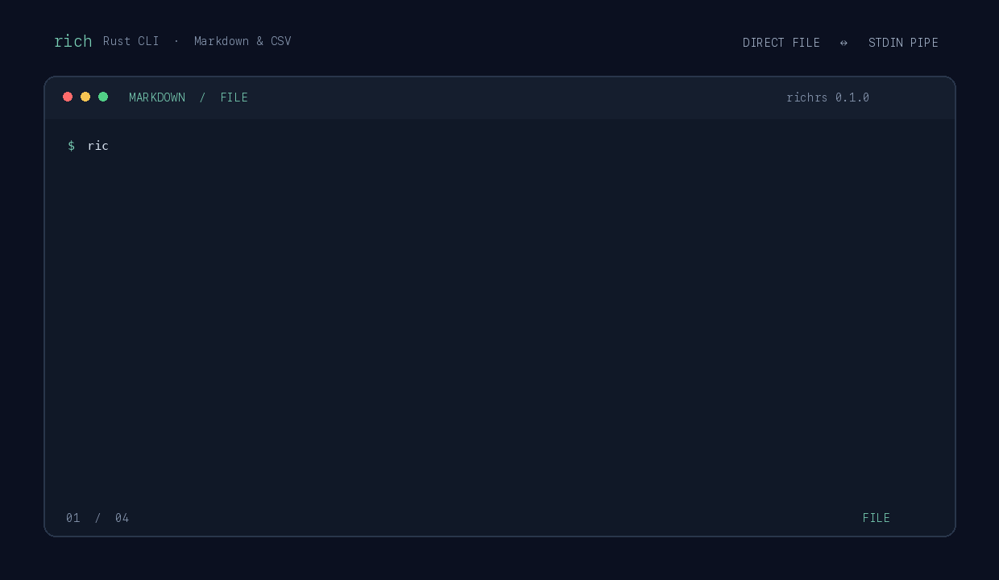

# richrs

A Rust implementation of Textualize's `rich` command-line tool. It installs as
`rich` and does not need Python at runtime.

This is an actively developed compatibility project, not a complete drop-in
replacement. Python-object inspection is unsupported; reStructuredText, syntax
colors, and layout have known differences. See the [compatibility notes](docs/COMPATIBILITY.md).



## Install

The `v0.1.0` cross-platform release is currently a GitHub draft. Once it is
published, install the latest version on macOS or Linux with:

```sh
curl -fsSL https://raw.githubusercontent.com/CarloNicolini/richrs/main/install.sh \
  | RICHRS_REPOSITORY=CarloNicolini/richrs sh
```

The installer verifies the archive checksum and installs to `$HOME/.local/bin`
without sudo. It supports Apple Silicon and Intel macOS, and x86_64 and ARM64
Linux. Set `RICHRS_VERSION` to pin a release or `RICHRS_INSTALL_DIR` to change
the install directory. Add `sh -s -- --force` to the command to replace an
existing binary.

The release also includes a Homebrew formula (`richrs.rb`). Download that formula
from the [release page](https://github.com/CarloNicolini/richrs/releases) and run
`brew install ./richrs.rb`. The formula uses the release archives and their
checksums.

## Use

```sh
rich README.md
rich src/main.rs --line-numbers --guides --theme dracula
rich data.csv --head 10 --title Results
rich analysis.ipynb
rich --print 'Hello [bold magenta]world[/]!' --emoji
printf '# Notes\n\nHello from stdin.\n' | rich - --markdown
```

Use `-` to read stdin. File extensions select formats; `--syntax`, `--json`,
`--markdown`, `--csv`, `--rst`, and `--ipynb` select one explicitly. The `--print`
and `--rule` options render literal console markup. `-h` means head; use
`--help` for help. `-J` selects JSON and `-j` enables emoji.

Piped output is plain text unless `--force-terminal` is set. Terminal output
respects `NO_COLOR` and `TERM=dumb`; `RICH_THEME` sets the default syntax theme.
`--pager` uses the built-in pager, or the program in `PAGER` when configured.

The command also supports HTML and SVG export, tables, Markdown, notebooks,
syntax highlighting, hyperlinks, and shell completions. Generate Bash, Zsh, or
Fish completions with `rich --generate-completions SHELL`; filename completion
uses the shell's normal file completion.

## Build and verify

Requires Rust 1.88+ and a C compiler.

```sh
cargo build --release --locked
cargo test --locked
cargo fmt --all -- --check
cargo clippy --locked --all-targets -- -D warnings
python3 tests/install.py
python3 tests/system.py
python3 tests/stress.py --mib 32
```

CI tests macOS and Linux. Tagged releases build Intel and Apple Silicon macOS
archives and x86_64 and ARM64 Linux archives. See [release instructions](docs/RELEASING.md).

## License

MIT. This independent project is not affiliated with Textualize. See [NOTICE](NOTICE)
for attribution and `docs/` for bundled data licenses.
